<!-- _class: title cover -->
<div class="cover-brand">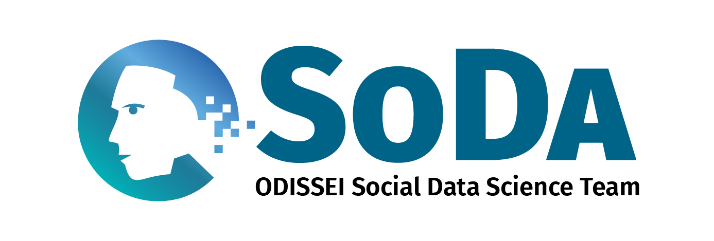</div>

# LLM-based data annotation
## Research workflows and FAIRR-LLM

<div class="cover-details">
Qixiang Fang<br>
Methodology, Statistics, and Data Science<br>
09.11.2026
</div>

---
<!-- _class: mission -->
# We help social scientists with data-intensive & computational research

Our goal is to enhance the evidence base and impact of social science by bringing the added value of new data sources and new data analysis techniques into social research in the Netherlands.

---
<!-- _class: team -->
# Who we are

<div class="team-layout">
<div class="team-copy">
<h2>Core team</h2>
<p>Computer and data scientists at postdoc or assistant professor level, with a social sciences background.</p>
<h2>Fellows</h2>
<p>Early career social scientists working on projects aligned with ODISSEI and SoDa’s mission.</p>
<h2>Student and research assistants</h2>
<p>Support SoDa projects and activities.</p>
<h2>Associate members</h2>
<p>Liaisons, including research software engineers from eScience, SCP etc.</p>
</div>
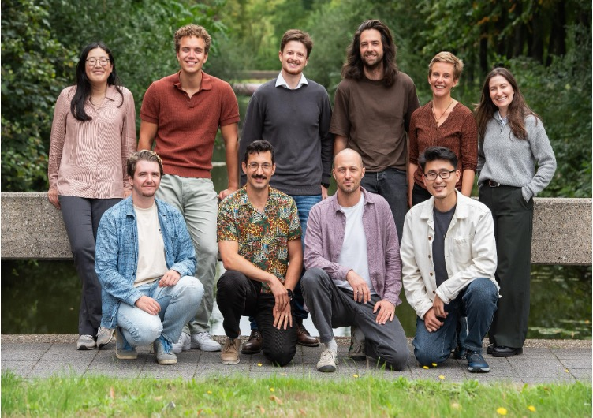
</div>

---
<!-- _class: fellowship -->
# Fellowship programme

<div class="fellowship-layout">
<div>

- **2–3 fellows per year**
- For PhD researchers, postdocs and assistant professors
- Propose your own social science research project
- **3–6 months full-time, with salary paid**
- Join the **SoDa team** at Utrecht University’s Methodology & Statistics department
- Receive mentoring from a senior team member

</div>
<div class="fellowship-deadline">
Next application deadline:<br>
<strong>7 December</strong>
</div>
</div>


---
# Measuring self-regulated learning

**Gabrielle Martins van Jaarsveld's SoDa fellowship project**

Students discuss their weekly learning goals with a rule-based chatbot.

<br>

> “I would like to catch up on my geography reading”

<br>

LLMs score goal characteristics using a carefully designed rubric (0–2).
The resulting variables support analyses of learning and study outcomes in a downstream multilevel model. 

---
# Insights from Gabrielle's SoDa fellowship

LLM-based annotations can be extremely useful, but:

1. no standard workflow
2. low reproducibility
3. overfitting
4. annotation error can bias downstream inference
5. overwhelming choices etc.

---
# Forthcoming in *Patterns*

> Fang, Q., van Kesteren, E.-J., & Garcia-Bernardo, J. (2026). A Methodological Guide to Reproducible Text Annotation with LLMs in SSH research. 

- LLMs as **measurement instruments** in empirical research
- Annotation error and downstream statistical inference
- Reproducible workflows, with Python and R examples
- **Explore, Select, Evaluate** for unbiased workflow development and assessment

---
# A workflow

includes prompt, model, settings, and data split etc.

**A workflow can overfit while the model weights stay fixed.**

---
<!-- _class: workflow -->
# Explore, Select, Evaluate

| Stage | Data role | Workflow decisions |
|---|---|---|
| Explore | Development cases | Inspect errors and revise candidates |
| Select | Separate comparison cases | Compare fixed candidates; choose and freeze one |
| Evaluate | Untouched assessment cases | Estimate the frozen workflow's performance |

---
# FAIRR-LLM

**Putting the paper's workflow into research practice**

- **Standardised annotation:** shared structure for data, prompts, and experiments
- **Protection against overfitting:** explicit splits, frozen workflows, and controlled evaluation
- **Reproducibility:** recorded prompt versions, model settings, and outputs
- **FAIR and open science:** an exportable code repository with data, metadata, and runnable Python

No programming required.

---
<!-- _class: screenshot -->
# The built-in tutorial

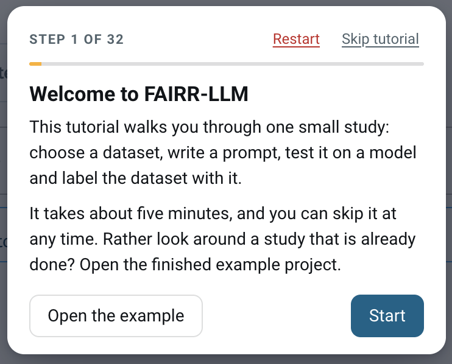

---
<!-- _class: screenshot -->
# Load the dataset and specify the reference-label column

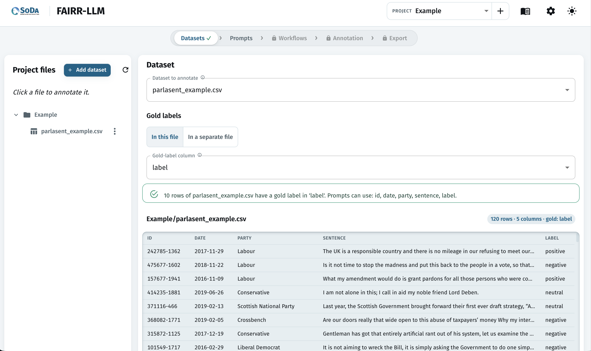

---
<!-- _class: screenshot -->
# Design and save a versioned prompt

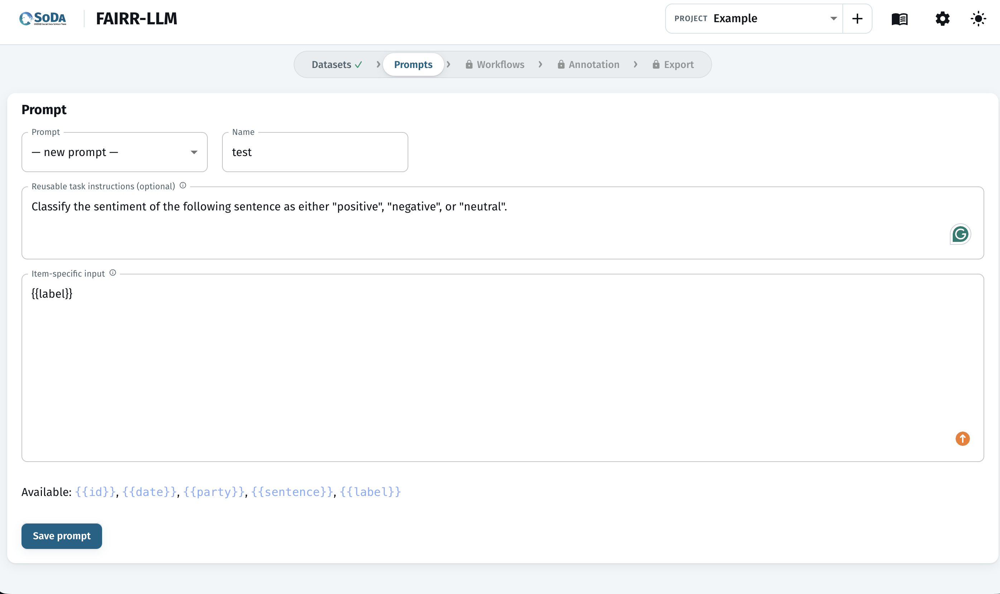

---
<!-- _class: screenshot -->
# Split the labelled data and freeze the split

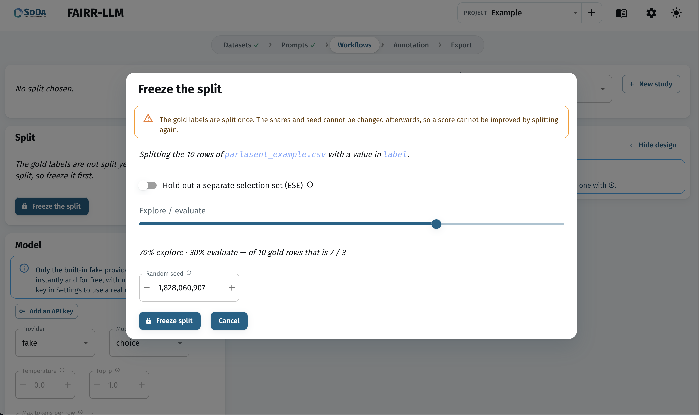

---
<!-- _class: screenshot -->
# Provide an API key

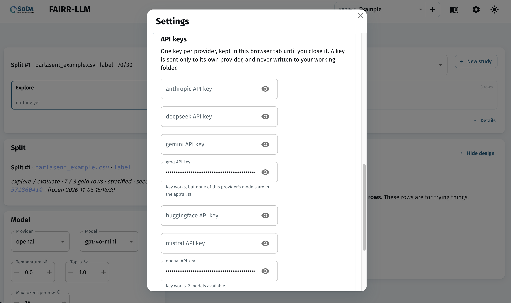

---
<!-- _class: screenshot -->
# Set up a model and define a workflow

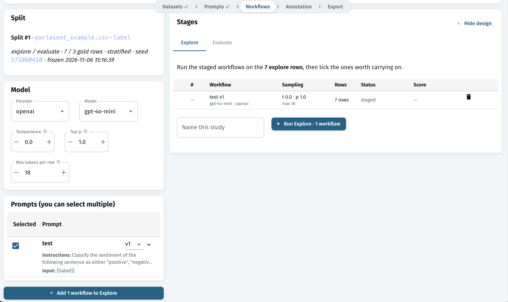

---
<!-- _class: screenshot -->
# Compare multiple workflows on Explore cases

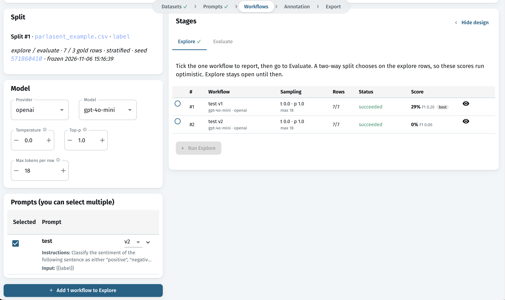

---
<!-- _class: screenshot -->
# Choose a workflow for final evaluation

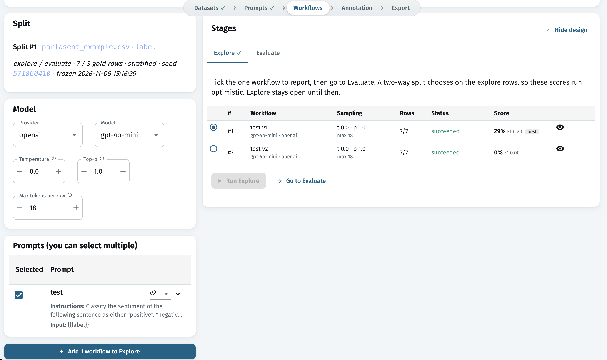

---
<!-- _class: screenshot -->
# Evaluate the chosen workflow on unseen cases

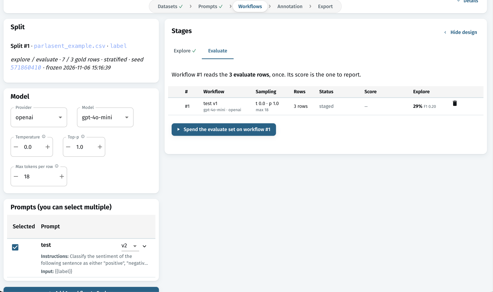

---
<!-- _class: screenshot -->
# Final evaluation: no way back

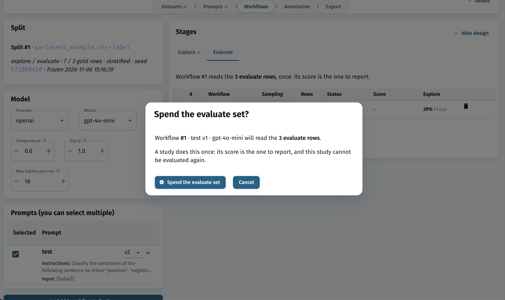

---
<!-- _class: screenshot -->
# Report held-out evaluation statistics

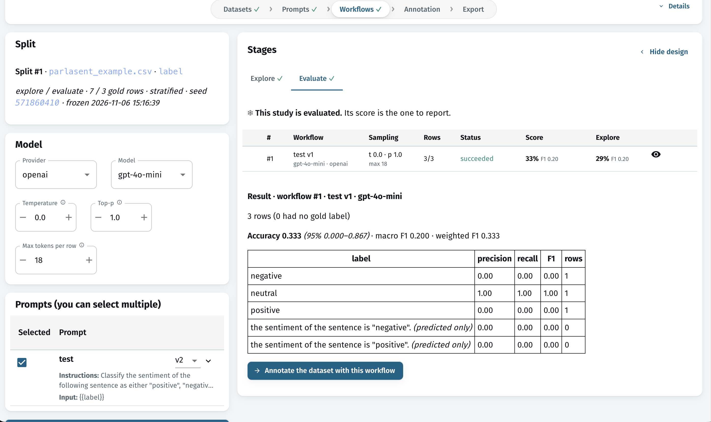

---
<!-- _class: screenshot -->
# Annotate unlabelled data with the evaluated workflow

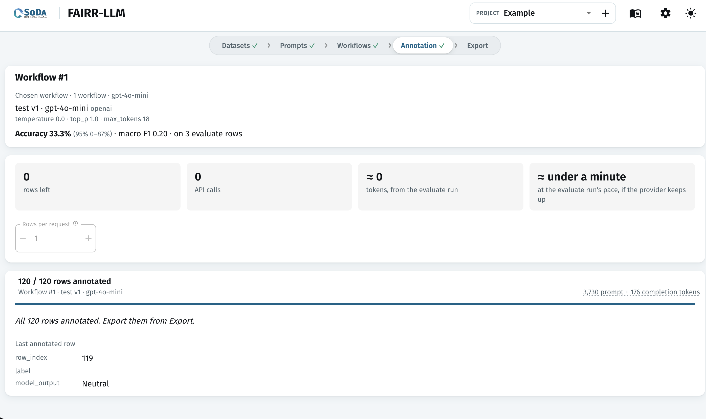

---
<!-- _class: screenshot -->
# Export everything into a reproducible folder

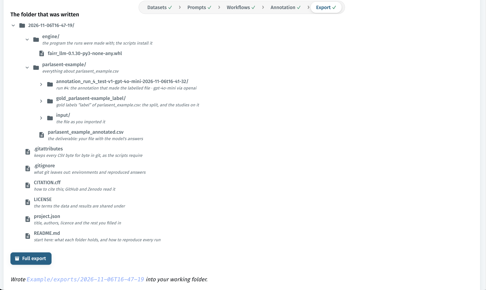


---
<!-- _class: small -->
# Try FAIRR-LLM: https://fairr-llm.odissei-soda.nl/
> We would love to get your feedback!

- Use **Chrome or Edge** and choose a working folder.
- Use your API key, or ask us for a **workshop key**.
- Open the default **UK parliamentary sentiment** example.
- Labels: positive, neutral, negative.

---
# A sentiment prompt

**Reusable instructions**

> Classify the sentiment of a sentence from a UK parliamentary debate as positive, neutral, or negative. Return one label only.

**Input template**

```text
Sentence: {{sentence}}
```

---
# Feedback and discussion
Where did you get stuck? 
What can be improved?
What features are missing?

